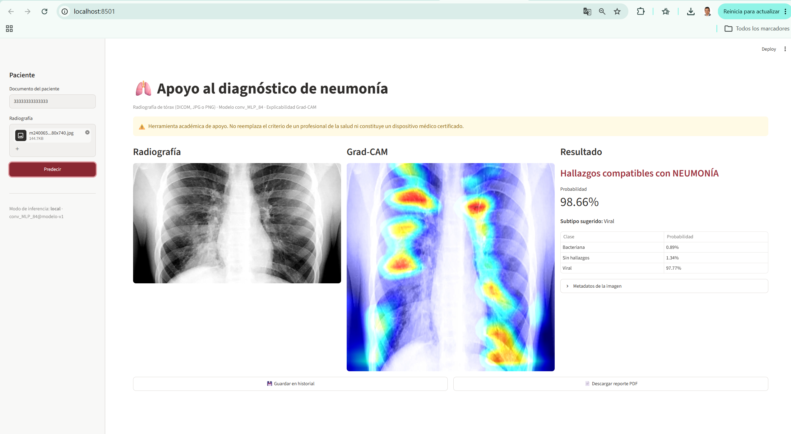
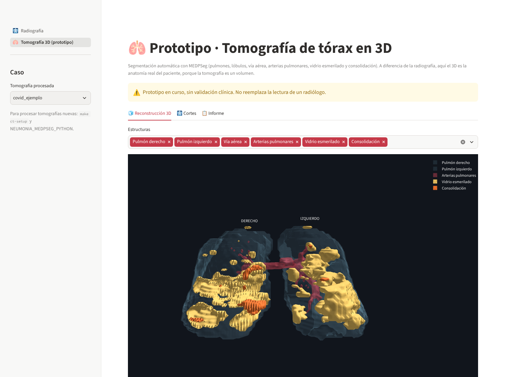
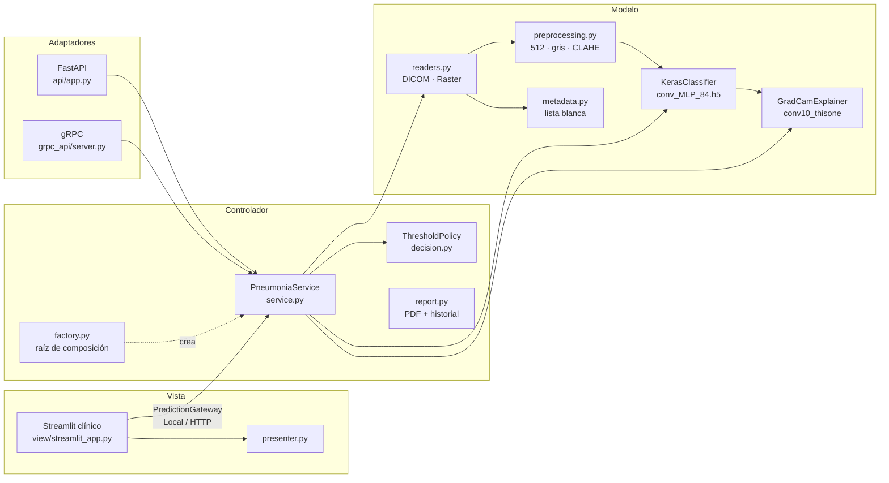
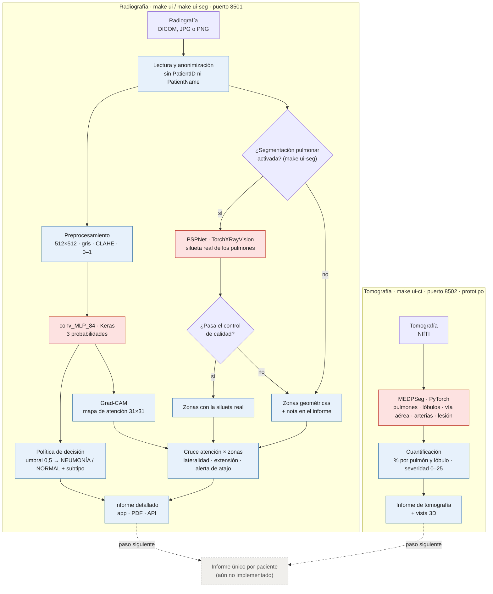

# Neumonía — caso base (Keras/TF + Grad-CAM)

> Proyecto integrador · **Gestión de Proyectos en IA y Ciencia de Datos** · Maestría en IA y CD · UAO 2026-2S
> Docente: Jan Polanco Velasco · Ruta local del proyecto: `C:\Neumonia`
>
> ⚠️ Herramienta **académica** de apoyo. No reemplaza el criterio de un profesional de la salud ni es un dispositivo médico.

Sistema que recibe una radiografía de tórax (**DICOM, JPG o PNG**), la clasifica como **NORMAL** o **PNEUMONIA**
(con subtipo sugerido *bacteriana / viral*), muestra un mapa de calor **Grad-CAM**, expone los **metadatos DICOM no
identificables** (edad, sexo, proyección) y genera un **reporte PDF**. Se usa desde una interfaz clínica en
Streamlit, una API REST (FastAPI) o gRPC, y corre en contenedores **CPU**.

El curso **no evalúa la exactitud del modelo**: evalúa que el artefacto se pueda **cargar, inferir, probar,
contenerizar y desplegar con un contrato claro**. Este repositorio cubre los cuatro verbos y los documenta.

| Radiografía | Tomografía 3D (prototipo) |
|---|---|
|  |  |

## 1. Fuente y licencia
- **Modelo**: `conv_MLP_84.h5` del caso base (UAO-Neumonía), Release público `modelo-v1`, SHA-256 verificado. Uso académico.
- **Código heredado**: [`dalquinones/UAO-Neumonia`](https://github.com/dalquinones/UAO-Neumonia) (monolito de 251 líneas refactorizado aquí).
- **Dataset con metadatos**: [RSNA Pneumonia Detection Challenge 2018](https://www.kaggle.com/competitions/rsna-pneumonia-detection-challenge)
  (investigación/educación con atribución) + muestras del aula. Complementario: Kermany *Chest X-Ray* (CC BY 4.0).
  Ver [`docs/dataset.md`](docs/dataset.md).

## 2. Estado de artifacts

| Artifact | Estado | Ubicación / cómo obtenerlo |
|---|---|---|
| Modelo | ✅ descarga verificada | `artifacts/model/conv_MLP_84.h5` (118 MB, ignorado por Git) · `make model` |
| Dataset aula | ✅ local | `data/JPG.zip`, `data/DICOM.zip` · `make data-course` → catálogo con metadatos |
| Dataset RSNA (metadatos) | ✅ script | `make dataset-rsna` (Kaggle) → `data/processed/rsna_metadata.csv` |
| Muestras de entrada | ✅ local | `artifacts/samples/` — 3 JPG + 2 DICOM (smoke, no miden calidad) |
| Contrato de salida | ✅ implementado | `api/openapi.yaml`, `api/README.md`, `artifacts/expected/response_example.json` |
| Docker CPU | ✅ | `docker/Dockerfile` (multi-etapa, no root, healthcheck) + `docker-compose.yml` |
| Smoke test | ✅ | `smoke_infer.py`, `tests/` (340 pruebas, 99 %), `scripts/container_smoke.py` |
| API | ✅ | FastAPI `:8000` (`/health`, `/predict`, `/docs`) + gRPC `:50051` |
| UI | ✅ | Streamlit clínico `:8501` |
| MLflow | ✅ | `make evaluate` · `make mlflow` |
| CI/CD | ✅ | `.github/workflows/ci.yml` (M1) · `.gitlab-ci.yml` (M4, Droplet) |
| Kit agéntico | ✅ | `CLAUDE.md`, `AGENTS.md`, `.claude/skills/` (10, incl. graphify), `.claude/agents/` (2), hooks |
| Arquitectura | ✅ | `docs/arquitectura/`: DESIGN.md + 12 diagramas C4/4+1 + trazabilidad metodologías ↔ arquitectura |
| Grafo (graphify) | ✅ | `graphify-out/` (1 025 nodos, 0 ciclos) · `make grafo` |
| Memoria (Engram) | ✅ | `.engram/` (19 decisiones y hallazgos, proyecto `neumonia`) · `make memoria` |

## 3. Inicio rápido en Windows (`C:\Neumonia`)

```powershell
# 1) Herramientas (una vez). Cierre y abra PowerShell después.
winget install astral-sh.uv Git.Git ezwinports.make Docker.DockerDesktop

# 2) Proyecto
cd C:\Neumonia
make install          # uv sync --frozen --all-groups  (Python 3.13 lo instala uv)
make model            # descarga conv_MLP_84.h5 y verifica SHA-256
make smoke            # ✓ 5 muestras · contrato OK
make check            # ruff + formato + 340 pruebas con cobertura ≥ 80 %

# 3) Usar
make backend          # http://localhost:8000/docs  (API FastAPI; carga el modelo al arrancar)
make frontend         # http://localhost:5173       (frontend desacoplado HTML/JS; otra terminal)
make ui               # http://localhost:8501       (app Streamlit interna; no se usa en la demo del M3)
make mlflow; make mlflow-runs   # MLflow + Model Registry en http://127.0.0.1:5050
```
Sin `make`: cada objetivo equivale a un comando `uv` (ver el `Makefile`), por ejemplo `uv run streamlit run src/neumonia/view/streamlit_app.py`.
Si TensorFlow falla por rutas largas en Windows: `New-ItemProperty -Path "HKLM:\SYSTEM\CurrentControlSet\Control\FileSystem" -Name LongPathsEnabled -Value 1 -PropertyType DWORD -Force` (PowerShell como administrador).

macOS / Linux: los mismos comandos (`brew install uv make` o `curl -LsSf https://astral.sh/uv/install.sh | sh`).

## 4. Comandos

| Comando | Qué hace |
|---|---|
| `make install` | Entorno idéntico a `uv.lock` |
| `make model` | Descarga y verifica el modelo |
| `make data-course` / `make dataset-rsna` / `make dataset-kermany` | Datos + catálogo de metadatos |
| `make mlflow` + `make mlflow-runs` | **MLflow del M3**: servidor y Model Registry en http://127.0.0.1:5050 y 3 corridas comparables (umbral 0.5, umbral 0.3, sin CLAHE) con calidad y latencia (SPEC-013) |
| `make backend` + `make frontend` | **Demo del M3**: API FastAPI (:8000) + frontend desacoplado HTML/JS (:5173) que la consume por HTTP (ADR-0013, SPEC-012) |
| `make ui` · `make api` · `make grpc` | App Streamlit interna, API REST, servidor gRPC |
| `make smoke` | Smoke test del curso (carga → infiere → valida contrato) |
| `make test` · `make test-fast` · `make cov` · `make check` | Pruebas y compuertas |
| `make lint` · `make format` · `make hooks` | Ruff y pre-commit |
| `make evaluate` · `make mlflow` | Evaluación con MLflow |
| `make docker-build` · `make docker-up` · `make docker-smoke` · `make docker-down` | Contenedores |
| `make grafo` · `make memoria` · `make memoria-exportar` · `make diagramas` | graphify, Engram y diagramas de arquitectura |
| `make proto` · `make clean` · `make help` | Stubs gRPC, limpieza, ayuda |

## 5. Contrato de inferencia
- **Entrada**: `POST /predict` · `multipart/form-data` con `file` (DICOM/JPG/PNG, ≤ 20 MB).
- **Salida**: `{ label: NORMAL|PNEUMONIA, probability, gradcam_url, subtype, class_probabilities, metadata, model_version, request_id }`
- **Errores**: `422` entrada inválida (`detail[].msg`) · `500 {"error": "..."}`.

```powershell
curl.exe -s -F "file=@artifacts/samples/viral (3).dcm" http://localhost:8000/predict
```
```json
{"label":"PNEUMONIA","probability":0.9921,"gradcam_url":"/static/gradcam/3c99….png","subtype":"viral",
 "class_probabilities":{"bacteriana":0.1039,"normal":0.0079,"viral":0.8882},
 "metadata":{"age":6,"sex":"F","view_position":"AP","modality":"CR","body_part":"CHEST"},
 "model_version":"conv_MLP_84@modelo-v1","request_id":"3c99…"}
```
`probability` es la de la etiqueta devuelta: `P(neumonía) = P(bacteriana) + P(viral)` (ADR-0003). Detalle: [`api/README.md`](api/README.md).

## 6. Arquitectura (MVC + Estrategia + DIP)

Documentación completa en **[`docs/arquitectura/`](docs/arquitectura/)**:
- [DESIGN.md](docs/arquitectura/DESIGN.md): diseño técnico con 12 diagramas (contexto, contenedores, componentes, clases, secuencias, despliegue, CI/CD, CRISP-DM, flujo agéntico y dependencias medidas con graphify).
- [METODOLOGIAS_ARQUITECTURA.md](docs/arquitectura/METODOLOGIAS_ARQUITECTURA.md): cada metodología relacionada con el componente que produce, su diagrama, su evidencia, su nodo en el grafo y su memoria en Engram.




```
C:\Neumonia
├── README.md · CLAUDE.md · AGENTS.md · Makefile · pyproject.toml · uv.lock · .python-version
├── smoke_infer.py                 # smoke del curso
├── src/neumonia/
│   ├── config.py · domain.py · evaluation.py
│   ├── model/        readers · metadata · preprocessing · classifier · gradcam · download
│   ├── controller/   service · decision · factory · gateways · report · errors
│   ├── view/         streamlit_app · presenter
│   ├── api/          app · schemas                (FastAPI)
│   ├── grpc_api/     neumonia.proto · server      (gRPC)
│   ├── data/         dataset                      (catálogo RSNA / Kermany / aula)
│   └── tracking/     tracker                      (MLflow)
├── artifacts/   model/ · samples/ · expected/
├── data/        JPG.zip · DICOM.zip · raw/ · processed/
├── api/         openapi.yaml · README.md
├── docker/      Dockerfile · README.md          + docker-compose.yml en la raíz
├── tests/       18 archivos · 340 pruebas
├── scripts/     fetch_model · fetch_dataset · evaluate · container_smoke · fetch_artifacts.sh
├── docs/        metodologias · dataset · M2_propuesta · model_card · M4_despliegue · postmortem · adr/ · img/
│   └── arquitectura/  DESIGN · METODOLOGIAS_ARQUITECTURA · GRAFO_GRAPHIFY · MEMORIA_ENGRAM · diagramas/ (12 .mmd + .svg)
├── graphify-out/  graph.json · graph.html · graph.svg · GRAPH_REPORT.md · wiki/
├── .engram/       config.json · manifest.json · chunks/   (memoria del proyecto)
├── specs/       especificaciones con criterios de aceptación
├── .claude/     settings.json · skills/ · agents/ · hooks/
└── .github/ · .gitlab/ · .gitlab-ci.yml · .pre-commit-config.yaml
```

Mejoras sobre el monolito:
- TensorFlow 1 (`K.gradients`, `disable_eager_execution`) migrado a `tf.GradientTape` (Keras 3).
- Grad-CAM pondera los **128** filtros, no solo 64.
- El lector JPG ya no pasa por `read_dicom_file`.
- Se maneja MONOCHROME1 y DICOM de 16 bits.
- El PDF se genera desde los datos, sin capturas de pantalla.
- El historial pasa a ser un CSV estándar con encabezado.
- No se expone PHI.

## 7. Metodologías (resumen)
Descripción completa y justificación de cada una en **[`docs/metodologias.md`](docs/metodologias.md)**. Su relación con cada componente de la arquitectura está en **[`docs/arquitectura/METODOLOGIAS_ARQUITECTURA.md`](docs/arquitectura/METODOLOGIAS_ARQUITECTURA.md)**.

| Metodología | Por qué se eligió |
|---|---|
| **CRISP-DM** + MLOps | Marco del curso; fases 1:1 con M2–M4; MLOps cubre su límite (operación continua) |
| **Data Thinking** | Empezar por el problema del médico (priorizar y explicar), no por el modelo |
| **DAMA-DMBOK** | Gobierno de datos: metadatos, calidad, privacidad, linaje y licencias |
| **Kanban** (Scrumban) | Equipo ≤ 4 con dedicación parcial y fechas fijas; WIP limitado |
| **BMC + OKR/KPI** | Exigidos en M2; valor medible (sensibilidad, latencia p95) |
| **Riesgos ISO 31000 + EU AI Act** | Apoyo diagnóstico = IA de alto riesgo; lista de obligaciones |
| **MVC + Estrategia + DIP** | DoD del M1 y Clase 1; 331 de 340 pruebas sin cargar el modelo |
| **Contract-first (OpenAPI)** + REST/gRPC | El curso evalúa "un contrato claro"; el modelo puede cambiar sin romper clientes |
| **Pirámide de pruebas + AAA + fitness functions** | DoD del M1; arquitectura verificada en CI |
| **uv + 12-factor + Docker** | Reproducibilidad (Windows, Linux, contenedor) con un solo `uv.lock` |
| **Gitflow + Conventional Commits + SemVer** | DoD del M1; `release/*` congela lo que se sustenta |
| **CI/CD con compuertas + DevSecOps** | M1 (GitHub Actions) y M4 (GitLab: Trivy, credenciales, despliegue manual) |
| **Modelo preentrenado** | El curso evalúa contrato y despliegue, no la métrica |
| **Paridad entrenamiento-servicio (CLAHE)** | Evita el *training-serving skew* (Sculley et al., 2015) |
| **Análisis de decisión (umbral)** | Contrato binario coherente; prioriza sensibilidad |
| **Grad-CAM** | XAI de una pasada en CPU; reveló un posible **atajo** (riesgo R-05) |
| **Evaluación por subgrupos** | Los metadatos RSNA permiten medir sesgo por sexo, edad y AP/PA |
| **MLflow** | Exigido en M3; cada cifra de la Model Card tiene un `run_id` |
| **Model Card + Datasheet** | Transparencia sobre usos y límites |
| **Privacidad desde el diseño** | Ley 1581/2012: datos de salud = sensibles |
| **Desarrollo con agentes (spec-driven)** | Productividad con reglas codificadas y control humano |

## 8. Desarrollo con consolas agénticas (Claude Code)

```powershell
irm https://claude.ai/install.ps1 | iex     # o: npm install -g @anthropic-ai/claude-code
cd C:\Neumonia
claude                                       # lee CLAUDE.md automáticamente
```
| Skill (`/nombre` o por descripción) | Para qué |
|---|---|
| `mvc-feature` | Agregar funcionalidad en la capa correcta (Estrategia/DIP) |
| `pytest-aaa` | Pruebas AAA con los dobles existentes |
| `api-contract` | Cambiar la API sin romper `label/probability/gradcam_url` |
| `dataset-rsna` | Descargar y catalogar RSNA/Kermany con licencia y privacidad |
| `mlflow-evaluacion` | Evaluar, comparar umbrales, leer subgrupos |
| `gradcam-review` | Auditar mapas de calor (atajos) |
| `gitflow-pr` | Ramas, commits, PR y releases |
| `docker-deploy` | Contenedores, Compose y Droplet |
| `entregables-curso` | Checklist M1–M4 y guion de sustentación |
| `graphify` | Construir y consultar el grafo de conocimiento (`/graphify .`) |

Subagentes: `revisor-arquitectura` (revisión de solo lectura antes del PR) y `escritor-pruebas`.

**graphify (mapa) + Engram (memoria)**:
- `make grafo` reconstruye `graphify-out/`. El agente consulta `uv run graphify query "..."` antes de leer archivos; un hook se lo recuerda. Detalle en [GRAFO_GRAPHIFY.md](docs/arquitectura/GRAFO_GRAPHIFY.md).
- `engram setup claude-code` (una vez) y luego `make memoria` cargan las 19 decisiones y hallazgos del proyecto. El agente las recupera con `mem_search` y no re-litiga ADR. Detalle en [MEMORIA_ENGRAM.md](docs/arquitectura/MEMORIA_ENGRAM.md).
Hooks: Ruff formatea cada `.py` editado; `guard_bash.py` bloquea `pip install`, `git add *.h5`, secretos y *push* forzado.
Ejemplo de sesión: *"Usa la skill mvc-feature para agregar soporte TIFF con su prueba y luego pide al subagente
revisor-arquitectura que revise el cambio."*

## 9. Entregables del curso

| Módulo | Peso | Evidencia |
|---|---|---|
| **M1** Código heredado, arquitectura y entorno | 25 % | MVC en `src/neumonia`, uv, 340 pruebas AAA, Docker CPU, Streamlit, CI + ruff + Gitflow, reporte PDF |
| **M2** Propuesta | 35 % | [`docs/M2_propuesta.md`](docs/M2_propuesta.md): Data Thinking, BMC, OKR/KPI, alternativas, historias con AC, cronograma, riesgos, Kanban |
| **M3** Construcción local | 25 % | FastAPI + gRPC, UI, MLflow, dataset RSNA con metadatos, Docker Compose |
| **M4** Producción | 15 % | [`.gitlab-ci.yml`](.gitlab-ci.yml), [`docs/M4_despliegue.md`](docs/M4_despliegue.md), [`docs/postmortem.md`](docs/postmortem.md) |

Documentos de soporte: [Model Card](docs/model_card.md) · [Dataset](docs/dataset.md) · [ADR](docs/adr/) ·
[Especificaciones](specs/) · [Declaración de uso de IA](docs/declaracion_uso_ia.md).

## 10. Smoke test mínimo (sección 5 del README del curso)
1. Cargar el modelo → `make model` + `tests/test_real_model.py::test_model_architecture`.
2. Inferir con una muestra de `artifacts/samples/` → `make smoke`.
3. Validar el JSON contra `artifacts/expected/response_example.json` → `smoke_infer.py` y `test_response_shape_matches_expected_example`.
4. Confirmar que el contenedor responde en `POST /predict` → `make docker-up && make docker-smoke`.

## 11. Resultados de referencia
`make evaluate` sobre las 16 imágenes del aula: exactitud 0.94, sensibilidad 1.00, especificidad 0.83, AUC 0.98.
**No mide generalización** (posible solapamiento con el entrenamiento). La evaluación honesta es RSNA, con métricas
por subgrupo en MLflow (ver Model Card). Hallazgo de Grad-CAM: en un DICOM pediátrico AP el modelo atiende al marcador de
lateralidad y a los bordes (posible aprendizaje por atajos).

## Evaluación de los modelos (radiografía y tomografía)
El sistema tiene dos partes, cada una con su propio modelo **preentrenado** (ninguno se entrenó en este proyecto).
Cada uno se evaluó por separado contra lo que marcaron radiólogos, con datos que el modelo no había visto. No se
combinan: en estos datasets ningún paciente tiene radiografía y tomografía a la vez.

| | Radiografía (proyecto principal, `make ui`) | Tomografía (prototipo, `make ui-ct`) |
|---|---|---|
| **Qué se evalúa** | El modelo `conv_MLP_84` | El modelo MEDPSeg |
| **Con qué datos** | RSNA: radiografías de adultos | COVID-19-CT-Seg: tomografías con COVID |
| **Pregunta** | ¿Acierta si hay neumonía? ¿Mira donde está la lesión? | ¿Dibuja la lesión donde la marcaron los radiólogos? |
| **Contra qué se compara** | Etiqueta de los radiólogos (opacidad sí/no) y sus cajas | Máscara de la lesión hecha por los radiólogos |
| **Medida** | Sensibilidad, especificidad, AUC; *pointing game* | Dice (coincidencia de la lesión) |
| **Resultado** | AUC 0,73 (500 casos); Grad-CAM acierta 2,7 % (300 casos); sesgo AP/PA | Dice 0,78 (1 caso) |
| **Detalle** | `docs/model_card.md`, ADR-0009 | ADR-0010, `specs/008-prototipo-tomografia.md` |

La evaluación de radiografía es la sólida (cientos de casos, con intervalos de confianza). La de tomografía es una
primera validación con 1 de las 20 tomografías del dataset.

Fuentes: RSNA Pneumonia Detection Challenge (Shih et al., 2019, *Radiology: AI*); COVID-19-CT-Seg (Ma et al., 2020,
Zenodo 3757476, CC BY 4.0); MEDPSeg (Carmo et al., 2026, licencia MIT).

## Modelos preentrenados y cómo se integran
En este proyecto no se entrenó ningún modelo: se usan tres modelos preentrenados y se miden con datos que no vieron.

| Modelo | Quién lo entrenó | Con qué datos | Qué hace aquí |
|---|---|---|---|
| `conv_MLP_84` (Keras) | Autores del proyecto original (Torres Revelo y Díaz Salazar), con la arquitectura de Pasa et al. | Radiografías de niños (Kermany) | Clasifica la radiografía: neumonía sí/no, bacteriana/viral |
| PSPNet (TorchXRayVision) | Cohen et al. | Radiografías anotadas (ChestX-Det) | Dibuja la silueta de los pulmones en la radiografía (opcional) |
| MEDPSeg (PyTorch) | Carmo et al. | Tomografías anotadas | Dibuja pulmones, lóbulos, vías y lesión en la tomografía |

### Ficha técnica y papel de cada modelo en el proceso
Ningún modelo hace solo todo el proceso. En la **radiografía**, `conv_MLP_84` detecta la infección y PSPNet ubica los
pulmones; su 3D es una **representación** de dónde miró el modelo, porque una radiografía es plana. En la
**tomografía**, MEDPSeg segmenta la lesión y el 3D sí es la **anatomía real** del paciente. La DenseNet-121 es una
alternativa a `conv_MLP_84` en evaluación (ADR-0011).

| | `conv_MLP_84` (modelo base) | DenseNet-121 RSNA | PSPNet | MEDPSeg |
|---|---|---|---|---|
| **Autores** | Torres Revelo y Díaz Salazar (arquitectura de Pasa et al.) | Cohen et al. (TorchXRayVision) | Cohen et al. (TorchXRayVision) | Carmo et al. |
| **Origen** | Release `modelo-v1` del caso base | Pesos `densenet121-res224-rsna` | `chestx_det` PSPNet | `data_poly.zip` v4.0.0 |
| **Framework** | Keras/TensorFlow | PyTorch | PyTorch | PyTorch |
| **Datos de entrenamiento** | Radiografías pediátricas (Kermany) | Radiografías de adultos (RSNA, imágenes del NIH) | ChestX-Det | Tomografías anotadas |
| **Tipo de imagen** | Radiografía | Radiografía | Radiografía | Tomografía |
| **Entrada** | 512×512, gris, CLAHE, 0–1 | 224×224, gris, [-1024, 1024] | 512×512 | Tomografía remuestreada a 1,5 mm |
| **Salida** | 3 probabilidades: bacteriana, normal, viral | Neumonía sí/no | 14 estructuras anatómicas | Pulmones, lóbulos, vía aérea, arterias, lesión |
| **Paso del proceso** | 1. Detectar la infección | 1. Detectar la infección (alternativa) | 2. Ubicar los pulmones | 1 a 3: segmentar, medir y reconstruir |
| **Determinación de la infección** | NEUMONÍA / NORMAL (umbral 0,5) y patrón bacteriano/viral **sugestivo, no validado** | Neumonía sí/no, sin patrón | No la determina: delimita los pulmones | Lesión segmentada (vidrio esmerilado y consolidación), % por pulmón y lóbulo, severidad 0–25 |
| **Localización** | Grad-CAM 31×31: dónde miró el modelo, **no** dónde está la lesión | Grad-CAM 7×7 (sin medir aún) | 6 zonas con la silueta real → lateralidad, extensión y alerta de atajo | La lesión vóxel a vóxel, en su pulmón y su lóbulo |
| **Vista 3D** | Relieve 3D de la atención y esquema de pulmones por zonas (**representación**) | La misma vista, con su Grad-CAM | Hace que el esquema por zonas siga la silueta real | **Reconstrucción 3D real** de pulmones, vía aérea, arterias y lesión |
| **Validación** | AUC 0,73 en 500 radiografías de RSNA; sesgo AP/PA; Grad-CAM acierta el 2,7 % | Pendiente: `make evaluate-test` (3000 radiografías no vistas) | Control de calidad automático; aprobado en 4 de 5 muestras | Dice 0,78 frente a radiólogos (1 de 20 tomografías de COVID-19-CT-Seg) |
| **Cómo se activa** | `make ui` (puerto 8501), siempre | `make ui-xrv` (rama `feature/clasificador-xrv`) | `make ui-seg` (opcional) | `make ui-ct` (puerto 8502, prototipo) |
| **Tamaño** | ≈ 118 MB | 28 MB | 273 MB | 768 MB |
| **SHA-256** | `d9548ff6…e18e` | `906a59f4…0268` | `019b167e…` | `b0890cd4…d659` |
| **Licencia** | Uso académico | Apache-2.0 | Apache-2.0 (código) | MIT (código) |

**El proceso completo, por tipo de imagen:**
1. **Radiografía:** `conv_MLP_84` (o la DenseNet-121) detecta la infección → Grad-CAM marca dónde miró → PSPNet (o las
   zonas geométricas) ubica los pulmones → el sistema cruza ambas cosas → informe por zonas, alerta de atajo y vista 3D
   de la atención.
2. **Tomografía:** MEDPSeg segmenta pulmones, lóbulos, vía aérea, arterias y lesión → el sistema mide el % comprometido
   y la severidad → reconstrucción 3D real con la lesión.
3. **Unión de los dos** en un informe por paciente: paso siguiente, aún no implementado.

### Flujo del sistema

Rojo: modelos preentrenados · azul: código del proyecto · gris punteado: paso siguiente, aún no implementado.

### ¿Cómo se integran hoy en el resultado?
**Sí se integran los dos de radiografía.** Cuando se activa la segmentación pulmonar (`make ui-seg`), el resultado
combina dos modelos sobre la misma imagen:

1. `conv_MLP_84` clasifica y Grad-CAM saca su mapa de atención.
2. PSPNet dibuja dónde están realmente los pulmones.
3. El código del proyecto cruza las dos cosas: cuánta atención cayó dentro y fuera de cada pulmón, en qué zona, y si
   hay que lanzar la alerta de atajo.

Ese "informe detallado" no lo produce ningún modelo solo; sale de combinarlos. Si PSPNet falla su control de calidad,
el sistema vuelve a las zonas geométricas y lo dice en el informe.

**La tomografía todavía no se integra.** Hoy son dos apps separadas, con dos informes separados: radiografía en el
puerto 8501 y tomografía en el 8502. No comparten paciente ni informe.

**Cómo se integraría** (paso siguiente, no implementado). Los modelos no se tocan: se unen sus **resultados** por
paciente, con reglas del controlador. Un informe integrado diría algo así (ejemplo ilustrativo):

> **Paciente 1144123456**
> - **Radiografía:** sugiere neumonía viral (0,97). Alerta de atajo: el modelo miró fuera de los pulmones; interpretar con cautela.
> - **Tomografía:** lesión de 871 mL, 15,7 % del pulmón (derecho 15,1 %, izquierdo 16,3 %), severidad 10/25.
> - **Lectura conjunta:** la tomografía confirma compromiso bilateral y mide su extensión.

La radiografía sirve para **detectar** y la tomografía para **medir**. Los modelos siguen evaluándose por separado
(tabla anterior) y su salida se junta en un solo informe.

**Limitación:** los casos disponibles son de pacientes distintos (radiografías de RSNA y del curso; tomografía de
COVID-19-CT-Seg), así que un informe integrado hoy sería ilustrativo. Validarlo exige un dataset con radiografía y
tomografía del mismo paciente.

## Autoría y créditos
**Esta versión** —arquitectura MVC, API REST y gRPC, interfaz clínica en Streamlit, pruebas, MLflow, Docker,
CI/CD y documentación— fue desarrollada por el equipo del proyecto en el curso Gestión de Proyectos en IA y
Ciencia de Datos, con asistencia de Claude Code (ver `docs/declaracion_uso_ia.md`).

**Componentes de terceros que esta versión reutiliza** (su cita es obligatoria):
- Modelo preentrenado `conv_MLP_84.h5`: caso base del curso, del proyecto original de I. Torres Revelo y N. Díaz Salazar. Uso académico.
- Arquitectura de la red: Pasa et al. (2019), *Scientific Reports* 9:6268.
- Dataset RSNA Pneumonia Detection Challenge: Shih et al. (2019), *Radiology: AI*; Radiological Society of North America.
- Imágenes de muestra: Kermany et al. (2018), Mendeley Data, CC BY 4.0.
