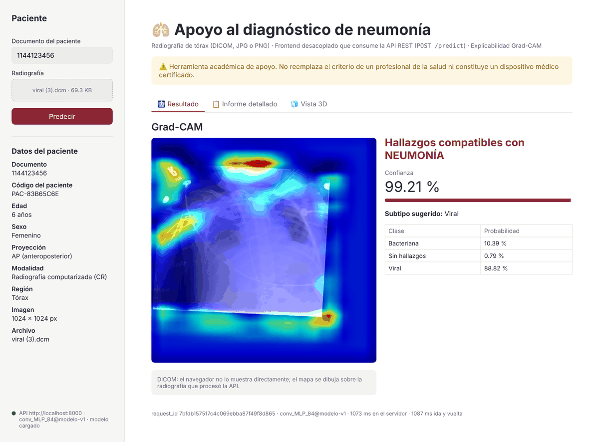
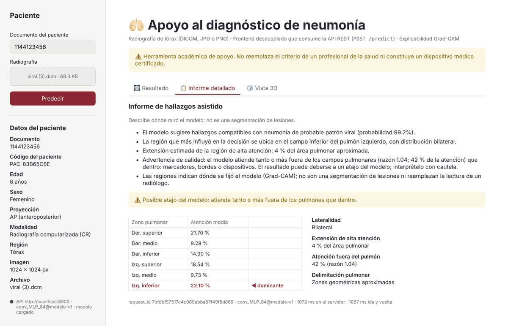
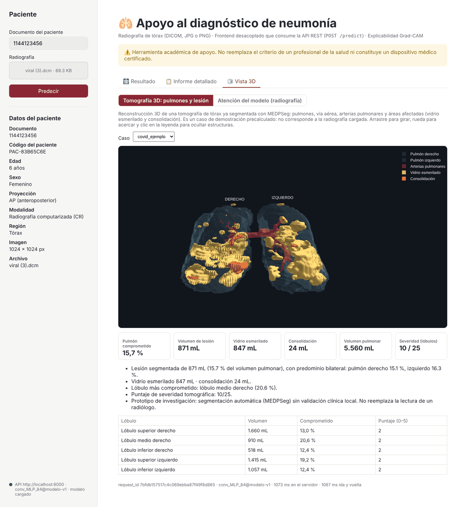
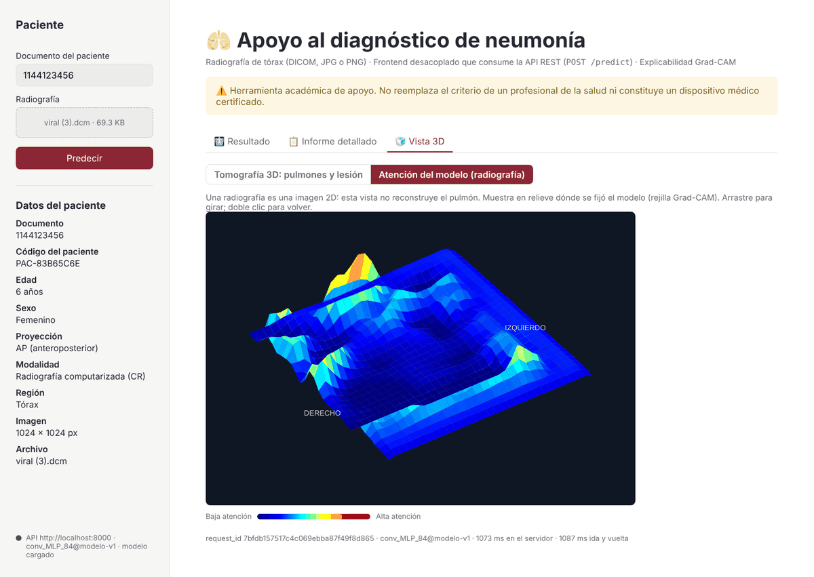
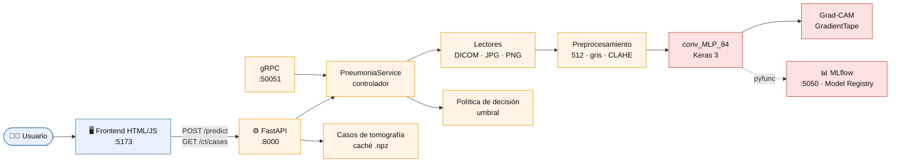
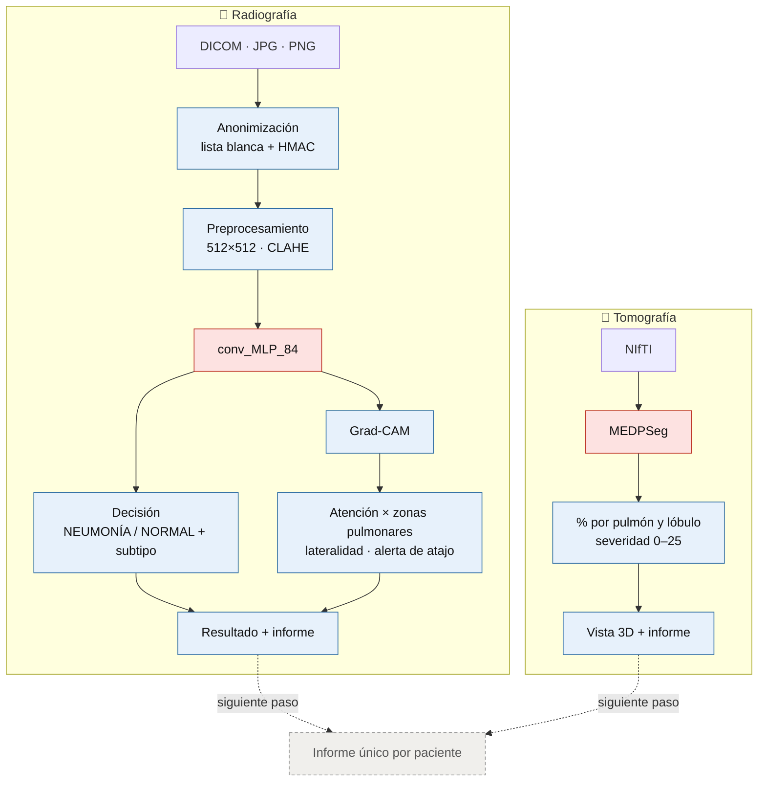

<div align="center">

# 🫁 Apoyo al diagnóstico de neumonía

### Radiografía de tórax → clasificación, explicación Grad-CAM e informe · Tomografía → pulmones y lesión en 3D

<p>
  
  
  
  
</p>
<p>
  
  
  
  
  
</p>

**Proyecto integrador · Gestión de Proyectos en Inteligencia Artificial y Ciencia de Datos · 2026-2S**<br>
Maestría en IA y Ciencia de Datos · UAO · Docente: Jan Polanco Velasco

[Demo](#-demo-en-3-comandos) ·
[Capturas](#-recorrido-visual) ·
[Arquitectura](#-arquitectura) ·
[Modelos](#-modelos-preentrenados) ·
[Resultados](#-resultados) ·
[Datos](#-datos) ·
[MLflow](#-mlflow-y-trazabilidad) ·
[Contrato](#-contrato-de-la-api) ·
[Entregables](#-entregables-del-curso)

</div>

> [!WARNING]
> Herramienta **académica** de apoyo. No reemplaza el criterio de un profesional de la salud ni constituye un
> dispositivo médico certificado.

---

## ✨ En una mirada

<table>
<tr>
<td width="25%" align="center">
<h3>🩻</h3>
<b>Clasifica</b><br>
<sub>NORMAL / NEUMONÍA con subtipo sugerido (bacteriana o viral) a partir de DICOM, JPG o PNG</sub>
</td>
<td width="25%" align="center">
<h3>🔥</h3>
<b>Explica</b><br>
<sub>Mapa Grad-CAM, informe por zonas pulmonares, lateralidad y alerta de <i>atajo</i> del modelo</sub>
</td>
<td width="25%" align="center">
<h3>🧊</h3>
<b>Reconstruye</b><br>
<sub>Tomografía en 3D: pulmones, arterias, vidrio esmerilado y consolidación, con % por lóbulo</sub>
</td>
<td width="25%" align="center">
<h3>🚀</h3>
<b>Despliega</b><br>
<sub>API REST y gRPC, frontend desacoplado, MLflow, Docker CPU y CI/CD con compuertas</sub>
</td>
</tr>
</table>

El curso no evalúa la exactitud del modelo: evalúa que el artefacto se pueda **cargar, inferir, probar,
contenerizar y desplegar con un contrato claro**. Este repositorio cubre los cuatro verbos, los mide y los
documenta.

<table>
<tr>
<th align="center">🔒 Privacidad</th>
<th align="center">🧪 Calidad</th>
<th align="center">📐 Diseño</th>
<th align="center">📝 Especificación</th>
</tr>
<tr>
<td align="center"><sub>Sin <code>PatientName</code>; el documento se convierte en un código seudónimo <code>PAC-…</code> (HMAC)</sub></td>
<td align="center"><sub>463 pruebas AAA, cobertura ≈ 97 %, Ruff y <i>fitness functions</i> de arquitectura en CI</sub></td>
<td align="center"><sub>MVC + Estrategia + DIP: el modelo se cambia sin tocar la API ni la vista</sub></td>
<td align="center"><sub>Desarrollo guiado por especificaciones: <code>spec.md</code>, <code>plan.md</code> y <code>tasks.md</code> por cambio</sub></td>
</tr>
</table>

---

## 🚀 Demo en 3 comandos

Tres terminales en `C:\Neumonia` (Windows; en macOS y Linux los comandos son los mismos):

| # | Terminal | Comando | Abre |
|:-:|---|---|---|
| 1 | 📊 MLflow | `make mlflow` | <http://127.0.0.1:5050> |
| 2 | ⚙️ Backend | `make backend` | <http://localhost:8000/docs> |
| 3 | 🖥️ Frontend | `make frontend` | <http://localhost:5173> |

> [!TIP]
> Primera vez: `make install` → `make model` → `make smoke`. Las corridas comparables de MLflow se registran con
> `make mlflow-runs`. Sin `make`, cada objetivo equivale a un comando `uv run …` del `Makefile`.

<details>
<summary><b>Instalación completa en Windows</b></summary>

```powershell
# 1) Herramientas (una vez). Cerrar y abrir PowerShell después.
winget install astral-sh.uv Git.Git ezwinports.make Docker.DockerDesktop

# 2) Proyecto
cd C:\Neumonia
make install          # uv sync --frozen --all-groups (Python 3.13 lo instala uv)
make model            # descarga conv_MLP_84.h5 y verifica SHA-256
make smoke            # ✓ 5 muestras · contrato OK
make check            # ruff + formato + pruebas con cobertura ≥ 80 %
```

Si TensorFlow falla por rutas largas en Windows (PowerShell como administrador):

```powershell
New-ItemProperty -Path "HKLM:\SYSTEM\CurrentControlSet\Control\FileSystem" -Name LongPathsEnabled -Value 1 -PropertyType DWORD -Force
```
</details>

---

## 📸 Recorrido visual

Frontend desacoplado (HTML/JS, puerto 5173) que consume la API REST por HTTP. No usa Streamlit.

<table>
<tr>
<td width="50%" align="center"><b>① Resultado</b><br><sub>Clase, confianza, subtipo y Grad-CAM</sub></td>
<td width="50%" align="center"><b>② Informe detallado</b><br><sub>Atención por zona pulmonar y alerta de atajo</sub></td>
</tr>
<tr>
<td></td>
<td></td>
</tr>
<tr>
<td width="50%" align="center"><b>③ Vista 3D · Tomografía</b><br><sub>Pulmones, arterias y áreas afectadas, con informe por lóbulo</sub></td>
<td width="50%" align="center"><b>④ Vista 3D · Atención del modelo</b><br><sub>Relieve de la rejilla Grad-CAM de la radiografía</sub></td>
</tr>
<tr>
<td></td>
<td></td>
</tr>
</table>

> [!NOTE]
> La tomografía 3D es un **caso de demostración precalculado** con MEDPSeg (COVID-19-CT-Seg); no corresponde a la
> radiografía cargada. En los datasets disponibles ningún paciente tiene radiografía y tomografía a la vez.

---

## 🏗️ Arquitectura



| Capa | Responsabilidad | Ubicación |
|---|---|---|
| 🖥️ **Vista** | Frontend desacoplado; consume la API por HTTP (ADR-0013) | `frontend/` |
| 🔌 **Adaptadores** | FastAPI (REST + CORS), gRPC | `src/neumonia/api/`, `src/neumonia/grpc_api/` |
| 🧭 **Controlador** | Servicio, política de decisión, informe, raíz de composición | `src/neumonia/controller/` |
| 🧠 **Modelo** | Lectores, metadatos en lista blanca, preprocesamiento, clasificador, Grad-CAM | `src/neumonia/model/` |
| 📊 **Seguimiento** | MLflow: corridas, métricas, artefactos y Model Registry | `src/neumonia/tracking/` |

La arquitectura se verifica en CI: una prueba prohíbe que la API importe la vista y que la vista importe el modelo.
Documentación completa, con 12 diagramas C4/4+1, en **[`docs/arquitectura/`](docs/arquitectura/)**: diseño técnico en
[`DESIGN.md`](docs/arquitectura/DESIGN.md) y vista de componentes MVC en
[`03-componentes-mvc.svg`](docs/arquitectura/diagramas/03-componentes-mvc.svg).

<details>
<summary><b>Mejoras sobre el monolito heredado</b></summary>

| Antes (monolito de 251 líneas) | Ahora |
|---|---|
| TensorFlow 1 (`K.gradients`, `disable_eager_execution`) | `tf.GradientTape` sobre Keras 3 |
| Grad-CAM con 64 de 128 filtros | Pondera los **128** filtros |
| JPG leído con `read_dicom_file` | Lector por formato (Estrategia) |
| Sin MONOCHROME1 ni 16 bits | Ambos soportados |
| PDF a partir de capturas de pantalla | PDF generado desde los datos |
| Historial sin encabezado | CSV estándar con encabezado |
| PHI expuesta | Metadatos en lista blanca y seudónimo HMAC |
</details>

<details>
<summary><b>Estructura del repositorio</b></summary>

```
C:\Neumonia
├── frontend/      index.html · app.js · styles.css · config.js   (demo M3)
├── src/neumonia/
│   ├── model/        readers · metadata · preprocessing · classifier · gradcam · ct_*
│   ├── controller/   service · decision · factory · report · ct_service · ct_analysis
│   ├── api/          app · schemas · ct_routes                    (FastAPI)
│   ├── grpc_api/     neumonia.proto · server                      (gRPC)
│   ├── view/         streamlit (uso interno, fuera de la demo)
│   ├── data/         catálogo RSNA / Kermany / aula
│   └── tracking/     MLflow
├── specs/         especificaciones SDD (spec · plan · tasks)
├── tests/         pruebas AAA + arquitectura
├── api/           openapi.yaml · README.md
├── docker/        Dockerfile multi-etapa · docker-compose.yml en la raíz
├── docs/          arquitectura · adr · model_card · dataset · M2 · M4 · img
└── .github/ · .gitlab-ci.yml · .claude/ (skills, agentes, hooks)
```
</details>

---

## 🧠 Modelos preentrenados

No se entrenó ningún modelo: se integran **tres modelos preentrenados** y se miden con datos que no vieron.

| | Modelo | Imagen | Función | Integración | Estado |
|:-:|---|:-:|---|---|:-:|
| 1️⃣ | **`conv_MLP_84`** · Keras | 🩻 Rx | **Clasifica** bacteriana / normal / viral | Núcleo de la API REST, gRPC y el frontend | 🟢 Siempre |
| ➕ | **Grad-CAM** · técnica | 🩻 Rx | **Explica** dónde miró la red (31×31) | Se cruza con zonas pulmonares → informe y alerta de atajo | 🟢 Siempre |
| 2️⃣ | **PSPNet** · TorchXRayVision | 🩻 Rx | **Segmenta** la silueta pulmonar real | Proceso aparte; control de calidad con respaldo geométrico | 🟡 Opcional |
| 3️⃣ | **MEDPSeg** · PyTorch | 🧊 TC | **Segmenta** pulmones, lóbulos, vía aérea, arterias y lesión | Precálculo en caché → `/ct/cases` → Vista 3D | 🟠 Prototipo |



<sub>Rojo: modelos preentrenados · azul: código del proyecto · gris punteado: siguiente paso, aún no implementado.</sub>

---

## 📈 Resultados

Cada modelo se evalúa por separado contra lo que marcaron radiólogos, con datos que el modelo no había visto.

<table>
<tr>
<th align="center">AUC RSNA</th>
<th align="center">Sensibilidad</th>
<th align="center">Especificidad</th>
<th align="center">Dice TC</th>
<th align="center">Lesión TC</th>
</tr>
<tr>
<td align="center"><h2>0,73</h2><sub>500 radiografías de adultos</sub></td>
<td align="center"><h2>0,74</h2><sub>IC 95 % 0,66–0,81</sub></td>
<td align="center"><h2>0,59</h2><sub>IC 95 % 0,54–0,64</sub></td>
<td align="center"><h2>0,78</h2><sub>precisión 0,93 · recall 0,67</sub></td>
<td align="center"><h2>15,7 %</h2><sub>871 mL · severidad 10/25</sub></td>
</tr>
</table>

### 🩻 Radiografía · `conv_MLP_84`

| Conjunto | n | Exactitud | Sensibilidad | Especificidad | AUC | Lectura |
|---|:-:|:-:|:-:|:-:|:-:|---|
| Muestras del aula | 16 | 0,94 | 1,00 | 0,83 | 0,98 | ⚠️ Posible solapamiento con el entrenamiento: no mide generalización |
| **RSNA estratificado** | **500** | **0,63** | **0,74** | **0,59** | **0,73** | ✅ Evaluación honesta; `run_id` en la Model Card |
| Opacidad vs. normal | 285 | — | 0,74 | 0,73 | 0,82 | Distingue bien «anormal» de «normal» |
| Opacidad vs. otra anormalidad | 335 | — | 0,74 | 0,48 | 0,66 | Le cuesta separar neumonía de otras patologías |

<details>
<summary><b>Matriz de confusión · RSNA 500</b></summary>

| | Predicho NEUMONÍA | Predicho NORMAL | |
|---|:-:|:-:|---|
| **Real: opacidad (120)** | ✅ VP = 89 | ❌ FN = 31 | Sensibilidad 0,74 |
| **Real: sin opacidad (380)** | ❌ FP = 156 | ✅ VN = 224 | Especificidad 0,59 |
| | VPP 0,36 | VPN 0,88 | |

Un VPN de 0,88 significa que un resultado NORMAL es bastante confiable. Un VPP de 0,36 significa que un resultado
NEUMONÍA pide confirmación. Ese perfil es coherente con una herramienta de **priorización**, no de diagnóstico.
</details>

<details>
<summary><b>Subgrupos y hallazgos de sesgo</b></summary>

| Variable | Grupo | n | Sensibilidad | Especificidad | AUC |
|---|---|:-:|:-:|:-:|:-:|
| Sexo | F | 227 | 0,72 | 0,61 | 0,72 |
| Sexo | M | 273 | 0,76 | 0,58 | 0,73 |
| Edad | 18–39 | 140 | 0,77 | 0,63 | 0,77 |
| Edad | 65+ | 66 | 0,81 | 0,56 | 0,75 |

- 🔴 **La proyección pesa más que el pulmón.** En AP el modelo predice neumonía casi siempre (especificidad 0,19).
  En PA casi nunca la predice (sensibilidad 0,30). Dentro de cada proyección el AUC cae a ≈ 0,60.
- 🟠 **Grad-CAM acierta la lesión en el 2,7 %** de 300 casos (*pointing game* contra las cajas de RSNA). En un
  DICOM pediátrico AP atiende al marcador de lateralidad y a los bordes: posible aprendizaje por atajos (riesgo R-05).
- 🟢 **Sexo:** sin diferencia relevante (AUC 0,72 frente a 0,73).
</details>

### 🧊 Tomografía · MEDPSeg (prototipo)

| Caso | Volumen pulmonar | Lesión | Vidrio esmerilado | Consolidación | Severidad | Dice vs. radiólogos |
|---|:-:|:-:|:-:|:-:|:-:|:-:|
| `covid_ejemplo` (COVID-19-CT-Seg) | 5 560 mL | 871 mL · **15,7 %** | 847 mL | 24 mL | **10 / 25** | **0,78** |

| Lóbulo | Volumen | Comprometido | Puntaje (0–5) |
|---|:-:|:-:|:-:|
| Superior derecho | 1 660 mL | 13,0 % | 2 |
| **Medio derecho** | 910 mL | **20,6 %** | 2 |
| Inferior derecho | 518 mL | 12,4 % | 2 |
| Superior izquierdo | 1 415 mL | 19,2 % | 2 |
| Inferior izquierdo | 1 057 mL | 12,4 % | 2 |

> [!IMPORTANT]
> La evaluación de radiografía es la sólida: cientos de casos, con intervalos de confianza. La de tomografía es una
> primera validación con 1 de las 20 tomografías del dataset.

---

## 🗂️ Datos

| Dataset | Tamaño | Metadatos | Etiquetas | Licencia | Uso |
|---|---|---|---|---|:-:|
| **[RSNA Pneumonia Detection Challenge (2018)](https://www.kaggle.com/competitions/rsna-pneumonia-detection-challenge)** | 26 684 DICOM 1024×1024 | Edad, sexo, proyección AP/PA, modalidad | Normal / opacidad / otra anormalidad, más **cajas** de radiólogos | Investigación y educación con atribución | ⭐ Principal |
| Muestras del aula | 16 imágenes (`JPG.zip`, `DICOM.zip`) | DICOM con cabecera | Clase del caso base | Uso académico | 🧪 Smoke |
| Kermany *Chest X-Ray* | 5 856 imágenes pediátricas | — | Normal / bacteriana / viral | CC BY 4.0 | ➕ Complementario |
| COVID-19-CT-Seg | 20 tomografías | — | Máscaras de lesión hechas por radiólogos | CC BY 4.0 | 🧊 Tomografía |

- Subconjunto estratificado reproducible: `--subset 2000 --seed 42`. Las imágenes no se versionan en Git; se
  descargan con `make dataset-rsna`.
- Detalle, alternativas descartadas (NIH ChestX-ray14, CheXpert, MIMIC-CXR) y *datasheet* en
  **[`docs/dataset.md`](docs/dataset.md)**.

---

## 📊 MLflow y trazabilidad

| Corrida | Variación | Qué compara |
|---|---|---|
| 1️⃣ Umbral 0,5 | Línea base | Contrato binario por defecto |
| 2️⃣ Umbral 0,3 | Umbral más bajo | Más sensibilidad a costa de especificidad |
| 3️⃣ Sin CLAHE | Preprocesamiento sin CLAHE | Efecto de la paridad entrenamiento-servicio |

- `make mlflow` levanta el servidor en **:5050**.
- `make mlflow-runs` registra las tres corridas con calidad y latencia.
- El modelo queda en el **Model Registry** como `pyfunc` con alias, y cada cifra de la Model Card tiene un `run_id`.
- Comparación en la interfaz: *Training runs* → seleccionar las 3 → **Compare**.

---

## 🔌 Contrato de la API

| Método | Ruta | Entrada | Salida |
|:-:|---|---|---|
| `GET` | `/health` | — | Estado y versión del modelo |
| `POST` | `/predict` | `multipart/form-data` · `file` (DICOM/JPG/PNG ≤ 20 MB) · documento opcional | Clase, probabilidad, subtipo, Grad-CAM, metadatos, hallazgos |
| `GET` | `/ct/cases` | — | Casos de tomografía procesados |
| `GET` | `/ct/cases/{id}` | — | Mallas 3D e informe por lóbulo |

```powershell
curl.exe -s -F "file=@artifacts/samples/viral (3).dcm" http://localhost:8000/predict
```

```json
{
  "label": "PNEUMONIA",
  "probability": 0.9921,
  "subtype": "viral",
  "class_probabilities": { "bacteriana": 0.1039, "normal": 0.0079, "viral": 0.8882 },
  "gradcam_url": "/static/gradcam/3c99….png",
  "metadata": { "age": 6, "sex": "F", "view_position": "AP", "modality": "CR", "body_part": "CHEST" },
  "model_version": "conv_MLP_84@modelo-v1",
  "request_id": "3c99…"
}
```

`probability` corresponde a la etiqueta devuelta: `P(neumonía) = P(bacteriana) + P(viral)` (ADR-0003).
Errores: `422` para entrada inválida y `500 {"error": "..."}`. Especificación completa en
[`api/openapi.yaml`](api/openapi.yaml); guía de uso en [`api/README.md`](api/README.md).

---

## 🧰 Comandos

| Grupo | Comandos | Para qué |
|---|---|---|
| 🏁 Arranque | `make install` · `make model` · `make smoke` | Entorno idéntico a `uv.lock`, modelo verificado y smoke |
| 🎬 Demo M3 | `make mlflow` · `make backend` · `make frontend` | MLflow :5050, API :8000, frontend :5173 |
| 📊 Experimentos | `make mlflow-runs` · `make evaluate` · `make evaluate-loc` | Corridas comparables, métricas y *pointing game* |
| 🧪 Calidad | `make test` · `make cov` · `make check` · `make lint` | Pruebas, cobertura y Ruff |
| 🗂️ Datos | `make data-course` · `make dataset-rsna` · `make dataset-kermany` | Datos y catálogo de metadatos |
| 🧊 Tomografía | `make ct-setup` · `make ct-precompute CT=...` | MEDPSeg y caché de casos 3D |
| 🐳 Contenedores | `make docker-build` · `make docker-up` · `make docker-smoke` | Docker CPU y Compose |
| 🧭 Conocimiento | `make grafo` · `make memoria` · `make diagramas` | graphify, Engram y diagramas |

---

## 🧭 Metodologías

<details>
<summary><b>21 metodologías y por qué se eligió cada una</b></summary>

| Metodología | Por qué |
|---|---|
| **CRISP-DM** + MLOps | Marco del curso; fases 1:1 con M2–M4 |
| **Data Thinking** | Partir del problema clínico (priorizar y explicar), no del modelo |
| **DAMA-DMBOK** | Gobierno de datos: metadatos, calidad, privacidad, linaje y licencias |
| **Kanban** (Scrumban) | Dedicación parcial y fechas fijas; WIP limitado en GitHub Projects |
| **BMC + OKR/KPI** | Valor medible: sensibilidad y latencia p95 |
| **ISO 31000 + EU AI Act** | El apoyo diagnóstico es IA de alto riesgo |
| **MVC + Estrategia + DIP** | La mayoría de las pruebas corren sin cargar el modelo |
| **Contract-first (OpenAPI)** + REST/gRPC | El modelo cambia sin romper clientes |
| **Pirámide de pruebas + AAA + fitness functions** | Arquitectura verificada en CI |
| **uv + 12-factor + Docker** | Reproducibilidad con un solo `uv.lock` |
| **Gitflow + Conventional Commits + SemVer** | `release/*` congela lo que se sustenta |
| **CI/CD con compuertas + DevSecOps** | GitHub Actions (M1) y GitLab con Trivy (M4) |
| **Spec-Driven Development** | Cada cambio con `spec.md`, `plan.md` y `tasks.md` |
| **Modelo preentrenado** | El curso evalúa contrato y despliegue, no la métrica |
| **Paridad entrenamiento-servicio (CLAHE)** | Evita el *training-serving skew* |
| **Análisis de decisión (umbral)** | Prioriza sensibilidad con contrato binario |
| **Grad-CAM** | XAI de una pasada en CPU; reveló un posible atajo |
| **Evaluación por subgrupos** | Sesgo por sexo, edad y proyección |
| **MLflow** | Cada cifra trazable a un `run_id` |
| **Model Card + Datasheet** | Transparencia sobre usos y límites |
| **Privacidad desde el diseño** | Ley 1581 de 2012: los datos de salud son sensibles |

Detalle en [`docs/metodologias.md`](docs/metodologias.md) y relación con la arquitectura en
[`docs/arquitectura/METODOLOGIAS_ARQUITECTURA.md`](docs/arquitectura/METODOLOGIAS_ARQUITECTURA.md).
</details>

---

## 🤖 Desarrollo con consolas agénticas

```powershell
irm https://claude.ai/install.ps1 | iex     # o: npm install -g @anthropic-ai/claude-code
cd C:\Neumonia
claude                                       # lee CLAUDE.md automáticamente
```

<details>
<summary><b>Skills, subagentes, hooks y memoria del proyecto</b></summary>

| Skill (`/nombre` o por descripción) | Para qué |
|---|---|
| `mvc-feature` | Agregar funcionalidad en la capa correcta (Estrategia/DIP) |
| `pytest-aaa` | Pruebas AAA con los dobles existentes |
| `api-contract` | Cambiar la API sin romper `label/probability/gradcam_url` |
| `dataset-rsna` | Descargar y catalogar RSNA/Kermany con licencia y privacidad |
| `mlflow-evaluacion` | Evaluar, comparar umbrales, leer subgrupos |
| `gradcam-review` | Auditar mapas de calor (atajos) |
| `gitflow-pr` | Ramas, commits, PR y releases |
| `docker-deploy` | Contenedores, Compose y Droplet |
| `entregables-curso` | Checklist M1–M4 y guion de sustentación |
| `graphify` | Construir y consultar el grafo de conocimiento (`/graphify .`) |

- **Subagentes:** `revisor-arquitectura` (revisión de solo lectura antes del PR) y `escritor-pruebas`.
- **graphify (mapa):** `make grafo` reconstruye `graphify-out/`; el agente consulta `uv run graphify query "..."`
  antes de leer archivos. Detalle en [`GRAFO_GRAPHIFY.md`](docs/arquitectura/GRAFO_GRAPHIFY.md).
- **Engram (memoria):** `engram setup claude-code` (una vez) y `make memoria` cargan las decisiones del proyecto;
  el agente las recupera con `mem_search` y no re-litiga ADR. Detalle en
  [`MEMORIA_ENGRAM.md`](docs/arquitectura/MEMORIA_ENGRAM.md).
- **Hooks:** Ruff formatea cada `.py` editado; `guard_bash.py` bloquea `pip install`, `git add *.h5`, secretos y
  *push* forzado.
</details>

---

## 🎓 Entregables del curso

| Módulo | Peso | Evidencia | Estado |
|---|:-:|---|:-:|
| **M1** · Código heredado, arquitectura y entorno | 25 % | MVC, uv, pruebas AAA, Docker CPU, CI + Ruff + Gitflow, PDF | ✅ |
| **M2** · Propuesta | 35 % | [`docs/M2_propuesta.md`](docs/M2_propuesta.md): Data Thinking, BMC, OKR/KPI, riesgos, Kanban ([tablero](https://github.com/users/JulianReneMunoz/projects/5) · [`docs/kanban.md`](docs/kanban.md)) | ✅ |
| **M3** · Construcción local | 25 % | Frontend desacoplado + FastAPI, MLflow :5050 con Registry, SDD en [`specs/`](specs/), PR en GitHub, [Kanban](docs/kanban.md) en GitHub Projects | ✅ |
| **M4** · Producción | 15 % | [`.gitlab-ci.yml`](.gitlab-ci.yml), [`docs/M4_despliegue.md`](docs/M4_despliegue.md), [`docs/postmortem.md`](docs/postmortem.md) | 🔜 |

**Documentos de soporte:** [Model Card](docs/model_card.md) · [Dataset](docs/dataset.md) · [ADR](docs/adr/) ·
[Especificaciones](specs/) · [Arquitectura](docs/arquitectura/) · [Declaración de uso de IA](docs/declaracion_uso_ia.md)

<details>
<summary><b>Estado de artifacts</b></summary>

| Artifact | Estado | Ubicación / cómo obtenerlo |
|---|:-:|---|
| Modelo | ✅ | `artifacts/model/conv_MLP_84.h5` (118 MB, ignorado por Git) · `make model` verifica SHA-256 |
| Dataset aula | ✅ | `data/JPG.zip`, `data/DICOM.zip` · `make data-course` → catálogo con metadatos |
| Dataset RSNA | ✅ | `make dataset-rsna` (Kaggle) → `data/processed/rsna_metadata.csv` |
| Muestras de entrada | ✅ | `artifacts/samples/` — 3 JPG + 2 DICOM (smoke, no miden calidad) |
| Contrato de salida | ✅ | `api/openapi.yaml`, `api/README.md`, `artifacts/expected/response_example.json` |
| Docker CPU | ✅ | `docker/Dockerfile` (multi-etapa, no root, healthcheck) + `docker-compose.yml` |
| Smoke test | ✅ | `smoke_infer.py`, `tests/`, `scripts/container_smoke.py` |
| API | ✅ | FastAPI `:8000` (`/health`, `/predict`, `/docs`) + gRPC `:50051` |
| Frontend | ✅ | HTML/JS desacoplado `:5173` (Streamlit `:8501` queda como app interna) |
| MLflow | ✅ | `make mlflow` · `make mlflow-runs` (Model Registry en `:5050`) |
</details>

<details>
<summary><b>Smoke test mínimo del curso</b></summary>

| Paso | Verificación | Evidencia |
|:-:|---|---|
| 1 | Cargar el modelo | `make model` + `tests/test_real_model.py` |
| 2 | Inferir con una muestra | `make smoke` |
| 3 | Validar el JSON contra el ejemplo | `smoke_infer.py` + `artifacts/expected/response_example.json` |
| 4 | El contenedor responde en `POST /predict` | `make docker-up && make docker-smoke` |
</details>

---

## 📚 Créditos y fuentes

La versión actual (arquitectura MVC, API REST y gRPC, frontend desacoplado, pruebas, MLflow, Docker, CI/CD y
documentación) se desarrolló en el marco del curso, con asistencia de Claude Code
(ver [`docs/declaracion_uso_ia.md`](docs/declaracion_uso_ia.md)).

| Componente reutilizado | Referencia |
|---|---|
| Modelo `conv_MLP_84.h5` | Caso base del curso (Torres Revelo y Díaz Salazar) · uso académico |
| Código heredado | [`dalquinones/UAO-Neumonia`](https://github.com/dalquinones/UAO-Neumonia) (monolito refactorizado aquí) |
| Arquitectura de la red | Pasa et al. (2019), *Scientific Reports* 9:6268 |
| Dataset RSNA | Shih et al. (2019), *Radiology: AI* 1(1):e180041 |
| Imágenes de muestra | Kermany et al. (2018), Mendeley Data, CC BY 4.0 |
| Tomografía | MEDPSeg, Carmo et al. (2026), licencia MIT · COVID-19-CT-Seg, Ma et al. (2020), Zenodo 3757476 |
| Segmentación pulmonar | TorchXRayVision, Cohen et al. (2022) · PSPNet con ChestX-Det (Lian et al., 2021) |

<div align="center">
<sub>🫁 Herramienta académica · no es un dispositivo médico · 2026-2S</sub>
</div>
