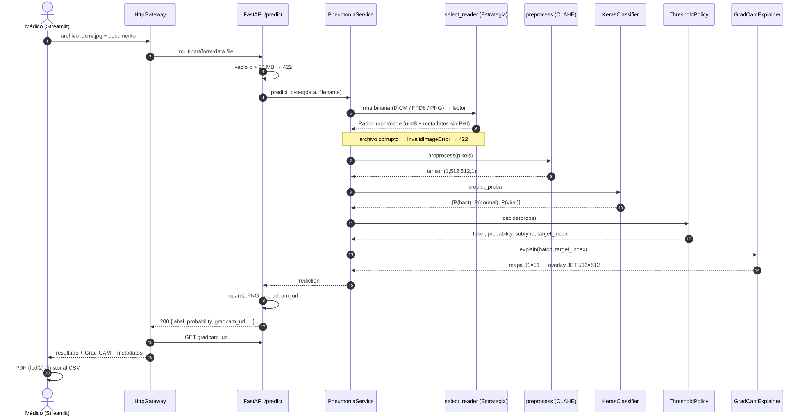
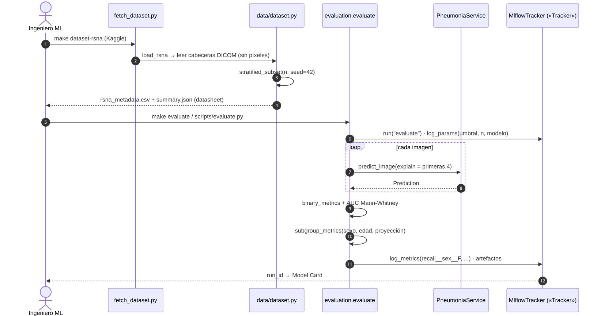

# DESIGN — Documento de diseño técnico del sistema Neumonía

> Fase **design** del desarrollo dirigido por especificaciones (spec → **design** → tasks → apply → verify).
> Responde **cómo** se construye lo que `specs/` y `docs/M2_propuesta.md` definen como **qué**.
> Vistas según **C4** (contexto → contenedores → componentes → código) y **4+1** (lógica, procesos, despliegue, desarrollo, escenarios).
> Cada diagrama tiene su fuente editable `.mmd` (Mermaid) y su exportación `.svg` en [`diagramas/`](diagramas/).
> Regenerar: `make diagramas`.

| Campo | Valor |
|---|---|
| Versión | 0.3.0 (M3 · construcción local) |
| Estado | Aprobado para M3; despliegue M4 en curso |
| Fuentes | `specs/`, `docs/M2_propuesta.md`, `docs/adr/`, `graphify-out/GRAPH_REPORT.md`, memoria Engram `neumonia` |
| Trazabilidad metodológica | [`METODOLOGIAS_ARQUITECTURA.md`](METODOLOGIAS_ARQUITECTURA.md) |

---

## 1. Propósito, alcance y no objetivos
**Propósito.** Sugerir NORMAL/PNEUMONIA en radiografías de tórax con explicación visual, de forma reproducible,
probada, contenerizada y desplegable en CPU, con un contrato de API estable.

**No objetivos.**
- Diagnóstico autónomo.
- Reentrenar el modelo.
- Integración real con un PACS.
- Certificación como dispositivo médico.
- Uso de GPU.

## 2. Impulsores de la arquitectura (*drivers*)

### 2.1 Requisitos funcionales clave
| Historia | Requisito | Componente principal |
|---|---|---|
| HU-01 | Clasificar DICOM/JPG/PNG | `PneumoniaService`, `readers`, `KerasClassifier`, `ThresholdPolicy` |
| HU-02 | Explicar con mapa de calor | `GradCamExplainer`, `overlay_heatmap` |
| HU-03 | PDF + historial | `controller/report.py` |
| HU-04 | Errores claros | `InvalidImageError` → 422, manejador global → 500 |
| HU-05 | Metadatos sin PHI | `model/metadata.py` (lista blanca) |
| HU-06 | Evaluar y comparar | `evaluation.py`, `tracking/`, MLflow |
| HU-07 | Desplegar con compuertas | `docker/`, `.gitlab-ci.yml` |
| HU-08 | gRPC | `grpc_api/` |

### 2.2 Atributos de calidad (escenarios medibles)
| Atributo | Escenario | Táctica | Evidencia |
|---|---|---|---|
| **Mantenibilidad / modificabilidad** | Cambiar el modelo por ONNX sin tocar la API | Protocolos + raíz de composición (DIP) | `Classifier`, `factory.py`, ADR-0001 |
| **Testabilidad** | Probar el controlador sin cargar 118 MB | Dobles de prueba inyectados | 367 de 377 pruebas sin el modelo real |
| **Conformidad arquitectónica** | La vista nunca importa el modelo | *Fitness function* en CI | `tests/test_architecture.py`; graphify: Vista→Modelo = 0 aristas |
| **Interoperabilidad** | Un cliente nuevo usa `/predict` sin leer el código | Contract-first OpenAPI + gRPC | `api/openapi.yaml`, `neumonia.proto` |
| **Rendimiento** | p95 de `/predict` < 3 s en 2 vCPU | Carga única del modelo (`lru_cache`), TF importado de forma perezosa, Grad-CAM opcional en lotes | `X-Process-Time-ms`; ≈1 s por imagen |
| **Seguridad / privacidad** | Un DICOM con nombre del paciente no lo filtra | Lista blanca de metadatos; respuestas sin rutas; usuario no root; SHA-256 | `test_response_has_no_local_paths`, `test_dicom_reader_never_leaks_identifiers` |
| **Portabilidad / reproducibilidad** | Mismo resultado en Windows, Linux y Docker | `uv.lock` multiplataforma, Python 3.13 fijo, 12-factor | CI matriz Ubuntu + Windows |
| **Explicabilidad** | El médico ve en qué se fijó la red | Grad-CAM sobre la clase decidida | HU-02; `gradcam-review` |
| **Disponibilidad** | El servicio se recupera solo si se cae | `HEALTHCHECK` + `restart: unless-stopped` + reversión por tag | `docker-compose.yml`, `docs/M4_despliegue.md` |

### 2.3 Restricciones
- **Del curso**: uv y Python 3.13, sin pip; MVC; pytest AAA; Docker CPU; Streamlit; CI con ruff; Gitflow.
- **Del modelo dado**: entrada 512×512×1 y preprocesamiento fijo.
- **Del contrato**: claves `label`, `probability` y `gradcam_url`.

---

## 3. Vistas de arquitectura

### 3.1 Contexto (C4-1)

Actores: médico, sistemas clínicos (REST/gRPC) y equipo. Dependencias externas: Release del modelo (SHA-256), RSNA en Kaggle, MLflow y GitLab/Droplet.
*Metodologías*: Data Thinking (actores), CRISP-DM (fuentes y despliegue), DAMA (procedencia de datos).

### 3.2 Contenedores (C4-2)

- `ui` (Streamlit, 8501) llama a `api` (FastAPI, 8000) por `HttpGateway`, así que la UI **no carga TensorFlow**.
- `grpc` (50051) comparte el mismo núcleo.
- `mlflow` se activa con el perfil `mlops`.
*Metodologías*: 12-factor (configuración por entorno), Docker CPU, contract-first.

### 3.3 Componentes (C4-3): MVC + Estrategia + DIP

| Capa | Módulo | Responsabilidad única | Patrón |
|---|---|---|---|
| Vista | `view/streamlit_app.py` | Dibujar widgets | Humble Object |
| Vista | `view/presenter.py` | Formatear resultado, validar documento | Presentador |
| Controlador | `controller/service.py` | Orquestar leer → preprocesar → predecir → explicar | Fachada + DIP |
| Controlador | `controller/decision.py` | Regla 3→2 clases y umbral | Estrategia |
| Controlador | `controller/gateways.py` | Elegir inferencia local o HTTP | Estrategia |
| Controlador | `controller/factory.py` | Crear las clases concretas | Raíz de composición |
| Controlador | `controller/report.py` | PDF y CSV | — |
| Modelo | `model/readers.py` | Leer DICOM/raster, detectar por firma | Estrategia |
| Modelo | `model/metadata.py` | Extraer metadatos permitidos | Lista blanca |
| Modelo | `model/preprocessing.py` | 512 · gris · CLAHE · /255 | Función pura |
| Modelo | `model/classifier.py` | Adaptar Keras | Adaptador (DIP) |
| Modelo | `model/gradcam.py` | Grad-CAM y superposición | Adaptador (DIP) |
| Modelo | `model/localization.py` | Atención por 6 zonas, lateralidad, extensión, alerta de atajo | Función pura (numpy/cv2) |
| Modelo | `model/lung_segmentation.py` | Campos pulmonares: geométricos o PSPNet, control de calidad con respaldo | Estrategia + Decorador |
| Modelo | `model/lung_worker.py` | Proceso hijo con PyTorch (TF y PyTorch no conviven) | Aislamiento de proceso |
| Vista | `view/overlays.py` | Pulmones, tercios y zona dominante sobre la radiografía | Función pura (numpy) |
| Controlador | `controller/findings.py` | Redacción prudente del informe de hallazgos | Regla de negocio |
| Vista | `view/visual3d.py` | Relieve 3D de Grad-CAM y esquema pulmonar 3D (Plotly) | Funciones puras, sin TF |
| Adaptadores | `api/app.py`, `grpc_api/server.py` | Exponer el controlador por red | Adaptador |

### 3.4 Código: dominio y abstracciones

Las seis interfaces `Protocol` (`ImageReader`, `Classifier`, `Explainer`, `DecisionPolicy`, `PredictionGateway`,
`Tracker`) son los **puntos de variación**. Cada una tiene al menos una implementación de producción y una de prueba o nula.

### 3.5 Dinámica: `POST /predict`

Puntos de decisión:
- **Tamaño y vacío**: se rechazan con 422 antes de leer.
- **Formato**: se detecta por **firma binaria** (`DICM` en el byte 128, `FFD8FF` o `\x89PNG`) antes que por extensión.
- **Decisión**: la toma `ThresholdPolicy`.
- **Grad-CAM**: se calcula sobre `target_index`, es decir, la clase de la decisión.

### 3.6 Dinámica: evaluación con metadatos y MLflow

### 3.7 Despliegue (M4)

### 3.8 Pipeline CI/CD con compuertas

### 3.9 Flujo de datos (CRISP-DM + MLOps)

### 3.10 Desarrollo agéntico (Claude Code + graphify + Engram)

- **graphify** es el *mapa* del código: estructura y relaciones.
- **Engram** es la *memoria* de las decisiones: el porqué.
- **CLAUDE.md** y las skills son las *reglas* y los *procedimientos*.

Ver [`GRAFO_GRAPHIFY.md`](GRAFO_GRAPHIFY.md) y [`MEMORIA_ENGRAM.md`](MEMORIA_ENGRAM.md).

### 3.11 Verificación: dependencias reales medidas con graphify

El grafo (1 025 nodos, 1 926 aristas, **sin ciclos de importación**) confirma con datos lo que exige el diseño:
- **Vista → Modelo = 0** aristas.
- **Modelo → Controlador/Vista/API = 0** aristas.
- El controlador concentra la orquestación: `PneumoniaService` es el nodo con más conexiones (43).

---

## 4. Decisiones de arquitectura (ADR)
| ADR | Decisión | Alternativas descartadas |
|---|---|---|
| [0001](../adr/0001-mvc-estrategia-dip.md) | MVC + Estrategia + DIP | Monolito; hexagonal completa |
| [0002](../adr/0002-modelo-preentrenado.md) | Reutilizar conv_MLP_84 con SHA-256 | Reentrenar; modelos HF de 2 clases |
| [0003](../adr/0003-politica-decision.md) | P(bact)+P(viral) ≥ umbral | Argmax de 3 clases |
| [0004](../adr/0004-dataset-rsna.md) | RSNA con metadatos | ChestX-ray14, CheXpert, MIMIC |
| [0005](../adr/0005-ui-api-gateway.md) | Streamlit + FastAPI + gRPC con pasarela | Tkinter con capturas |
| [0006](../adr/0006-mlflow-sqlite.md) | MLflow con SQLite | File store (en mantenimiento) |
| [0007](../adr/0007-hallazgos-por-zonas-y-vista-3d.md) | Hallazgos por zonas + vistas 3D de la atención (aditivo) | Segmentación U-Net; detector RSNA; reconstrucción 2D→3D |
| [0008](../adr/0008-segmentacion-pulmonar-pspnet.md) | Segmentación pulmonar PSPNet opcional, en proceso aparte, con respaldo geométrico | SAM 3 con texto; U-Net propia |

Las mismas decisiones viven en la memoria Engram (`engram search "decision" --project neumonia`).

## 5. Interfaces
| Interfaz | Especificación |
|---|---|
| REST | `api/openapi.yaml` — `GET /health`, `POST /predict`, `GET /static/gradcam/{id}.png` |
| gRPC | `src/neumonia/grpc_api/neumonia.proto` — `Predict`, `Health` |
| Configuración | `NEUMONIA_MODEL_PATH`, `NEUMONIA_THRESHOLD`, `NEUMONIA_API_URL`, `NEUMONIA_MAX_UPLOAD_MB`, `NEUMONIA_LUNG_SEGMENTER`, `NEUMONIA_STATIC_DIR`, `NEUMONIA_HISTORY_PATH`, `MLFLOW_TRACKING_URI` |
| Datos | `data/processed/<fuente>_metadata.csv` (columnas en `docs/dataset.md`) |
| Hallazgos | `findings` en `/predict` (ADR-0007, spec 005), sección del PDF y pestañas *Informe detallado* / *Vista 3D* |
| Artefactos | `artifacts/model/conv_MLP_84.h5` (SHA-256 fijo), `runtime/` (salidas) |

## 6. Estrategia de pruebas
Pirámide: unitarias (lectores, metadatos, decisión, métricas) → integración (API, gRPC, Keras mínimo, MLflow) →
extremo a extremo (modelo real, `smoke_infer.py`, `container_smoke.py`) → arquitectura (`test_architecture.py`).
En total son 377 pruebas, con 98 % de cobertura y una compuerta de 80 %. Mapa completo: `tests/README.md`.

## 7. Riesgos técnicos y deuda conocida
| Riesgo / deuda | Impacto en el diseño | Plan |
|---|---|---|
| Atajos del modelo (Grad-CAM en marcadores y bordes) | El diseño no puede corregirlo: es del modelo | Recorte pulmonar como nueva Estrategia de preprocesamiento opcional |
| TensorFlow y PyTorch en el mismo proceso abortan (LLVM) | PSPNet debe ir aparte | Proceso hijo `lung_worker`; regla de arquitectura que exige importar PyTorch de forma perezosa |
| Probabilidades no calibradas | `probability` no es una frecuencia | `CalibratedClassifier` que envuelva a `Classifier` (decorador) |
| Imagen Docker de ~1.8 GB | Despliegues lentos | Exportar a ONNX + `onnxruntime` (otra implementación de `Classifier`) |
| SQLite en MLflow | No concurrente | PostgreSQL sin cambiar código (`MLFLOW_TRACKING_URI`) |
| `gradcam_url` en disco local | No escala a varias réplicas | Almacenamiento de objetos (S3/Spaces) detrás de una interfaz |

## 8. Cómo evolucionar el diseño
Agregar un formato, un modelo, una regla o una interfaz es **agregar una clase** que cumpla un `Protocol` y registrarla
en `factory.py` (principio abierto/cerrado). Procedimiento: skill `mvc-feature`. Después, `make grafo` actualiza el
mapa y `make memoria` registra la decisión.
