# Metodologías ↔ Arquitectura: trazabilidad y explicación

> Relaciona cada una de las 23 metodologías del proyecto con el **elemento de arquitectura** que produce, el
> **diagrama** donde se ve, la **evidencia** verificable (archivo o prueba), el **nodo del grafo graphify** que la
> conecta con el código y la **memoria Engram** que conserva la decisión.
> La justificación de *por qué se eligió* cada metodología está en [`../metodologias.md`](../metodologias.md); aquí se
> explica *cómo se materializa en la arquitectura*.



## 1. Matriz de trazabilidad

Columnas: **V** Vista · **C** Controlador · **M** Modelo · **A** Adaptadores (REST/gRPC) · **D** Datos/Evaluación/Tracking ·
**I** Infraestructura (Docker/CI/CD) · **Doc** Documentación · **K** Kit agéntico.

| # | Metodología | V | C | M | A | D | I | Doc | K | Diagrama |
|---|---|:-:|:-:|:-:|:-:|:-:|:-:|:-:|:-:|---|
| 1 | CRISP-DM + MLOps | | | | | ● | ● | ● | | 09 |
| 2 | Data Thinking | ● | | | | | | ● | | 01 |
| 3 | DAMA-DMBOK | | | ● | | ● | | ● | | 06, 09 |
| 4 | Kanban | | | | | | | ● | ● | 11 |
| 5 | BMC + OKR/KPI | | | | | ● | | ● | | 09 |
| 6 | Riesgos ISO 31000 + EU AI Act | ● | | | | ● | ● | ● | | 08 |
| 7 | MVC | ● | ● | ● | | | | | | 03, 12 |
| 8 | SOLID: Estrategia + DIP | | ● | ● | | ● | | | | 03, 04 |
| 9 | Humble Object | ● | | | | | | | | 03 |
| 10 | Contract-first (OpenAPI/gRPC) | | | | ● | | | ● | | 02, 05 |
| 11 | Pirámide de pruebas AAA + *fitness functions* | | ● | ● | ● | | ● | | ● | 08, 12 |
| 12 | uv + 12-factor + Docker | | | | ● | | ● | | | 02, 07 |
| 13 | Gitflow + Conventional Commits + SemVer | | | | | | ● | | ● | 07, 11 |
| 14 | CI/CD con compuertas + DevSecOps | | | | | | ● | | ● | 08 |
| 15 | Reutilizar modelo preentrenado | | | ● | | | ● | ● | | 01, 03 |
| 16 | Paridad entrenamiento-servicio | | | ● | | | | | | 05 |
| 17 | Análisis de decisión (umbral) | | ● | | | ● | | ● | | 05 |
| 18 | Grad-CAM (XAI) | ● | ● | ● | | ● | | ● | | 05 |
| 19 | Evaluación por subgrupos | | | | | ● | | ● | | 06 |
| 20 | MLflow | | | | | ● | ● | | | 02, 06 |
| 21 | Model Card + Datasheet | | | | | ● | | ● | | 09 |
| 22 | Privacidad desde el diseño | ● | ● | ● | ● | | ● | | ● | 03, 05 |
| 23 | Spec-driven + agentes (Claude Code, graphify, Engram) | | | | | | | ● | ● | 11 |

---

## 2. Explicación por metodología

Formato: **Elemento** · **Cómo lo moldea** · **Evidencia** · **graphify** (nodos conectados) · **Engram** (topic).

### A. Gestión y ciclo de vida

**1. CRISP-DM + MLOps**
- **Elemento**: el flujo completo del diagrama 09 y la separación entre `data/` (comprensión y preparación),
  `evaluation.py` (evaluación) y `api/`/`docker/` (despliegue).
- **Cómo lo moldea**: cada fase tiene un paquete o documento propio. Por eso la evaluación es un módulo aparte que
  **reutiliza** el mismo `PneumoniaService` del servicio y no tiene una copia de la lógica. La extensión MLOps agrega
  las flechas de retorno: monitoreo → deriva → datos, y el post-mortem.
- **Evidencia**: `scripts/evaluate.py` llama a `build_service()`, el mismo constructor de la API.
- **graphify**: `evaluate()` está entre los 3 nodos más conectados y es el puente entre `dataset.py`, `PneumoniaService` y `Tracker`.
- **Engram**: `decision/metodologias`.

**2. Data Thinking**
- **Elemento**: la vista clínica (diagrama 01, actor "médico") y el requisito de explicabilidad visual.
- **Cómo lo moldea**: el usuario es un médico no radiólogo que necesita saber *dónde* mirar. Por eso Grad-CAM se muestra
  en la UI junto a la radiografía, el aviso de "apoyo" es permanente y el PDF existe para la historia clínica.
- **Evidencia**: `view/streamlit_app.py` (tres columnas: radiografía, Grad-CAM, resultado); `docs/M2_propuesta.md` §1.
- **Engram**: `decision/ui-gateway`.

**3. DAMA-DMBOK (gobierno de datos)**
- **Elemento**: `model/metadata.py`, el catálogo `data/processed/*_metadata.csv` y la datasheet.
- **Cómo lo moldea**:
  - *Metadatos*: el catálogo tiene columnas definidas.
  - *Calidad*: la validación ocurre en la frontera, en los lectores.
  - *Seguridad*: lista blanca de metadatos.
  - *Linaje*: el modelo se identifica por URL + SHA-256 y cada dataset por su cita y licencia.
- **Evidencia**: `SAFE_FIELDS` / `FORBIDDEN_FIELDS`; `test_extract_metadata_keeps_only_safe_fields`.
- **graphify**: comunidad `extract_metadata` (lectores ↔ metadatos ↔ pruebas).
- **Engram**: `decision/dataset-rsna`, `decision/privacidad`.

**4. Kanban (Scrumban)**
- **Elemento**: el flujo de trabajo del kit agéntico (diagrama 11): especificación → código → compuerta → PR.
- **Cómo lo moldea**: la columna "En revisión" es el PR; la *Definition of Done* se convirtió en `make check` y en la
  plantilla de PR. Así el tablero refleja estados que el sistema puede verificar.
- **Evidencia**: `.github/pull_request_template.md`, `docs/M2_propuesta.md` §10.

**5. BMC + OKR/KPI**
- **Elemento**: los KPI se volvieron **señales instrumentadas**.
  - Latencia: cabecera `X-Process-Time-ms` en el middleware.
  - Sensibilidad: métrica `recall` en MLflow.
  - Equidad: `recall__sex__*`.
- **Cómo lo moldea**: un KR que no se puede medir no se puede cumplir. Por eso la API mide y la evaluación registra.
- **Evidencia**: middleware `timing` en `api/app.py`; `evaluation.py::evaluate`.

**6. Gestión de riesgos (ISO 31000) + EU AI Act**
- **Elemento**: los **controles** de la arquitectura.
  - Aviso en la UI y el PDF (transparencia).
  - `request_id` y logs (registro de eventos).
  - Despliegue **manual** (supervisión humana).
  - Trivy (robustez de la cadena de suministro).
  - Métricas por subgrupo (sesgo).
- **Cómo lo moldea**: cada riesgo alto de la matriz (R-01 a R-05) tiene un componente que lo mitiga en el diagrama 08
  o el 05.
- **Evidencia**: `.gitlab-ci.yml` (`when: manual`, job `trivy`), `report.py::DISCLAIMER`.

### B. Ingeniería de software

**7. MVC**
- **Elemento**: las tres capas del diagrama 03 (`view/`, `controller/`, `model/`).
- **Cómo lo moldea**: la dirección de las dependencias es **Vista → Controlador → Modelo**, nunca al revés.
  REST y gRPC son adaptadores adicionales sobre el mismo controlador, así que la lógica no se duplica.
- **Evidencia**: `tests/test_architecture.py` (prueba con AST, en CI).
- **graphify**: el diagrama 12 mide **0 aristas Vista→Modelo y 0 aristas Modelo→Controlador**. La sección
  "7. Modelo-Vista-Controlador" de `metodologias.md` aparece enlazada a `PneumoniaService` en *Surprising Connections*.
- **Engram**: `architecture/mvc-estrategia-dip`.

**8. SOLID: Estrategia + Inversión de dependencias**
- **Elemento**: los seis `Protocol` del diagrama 04 y la raíz de composición `factory.py`.
- **Cómo lo moldea**:
  - *Estrategia*: lectores, política de decisión y pasarelas intercambiables.
  - *DIP*: el servicio depende de `Classifier`, `Explainer` y `Tracker`, no de Keras ni de MLflow.
- **Evidencia**: `FakeClassifier` sustituye a Keras en 300 pruebas; `HttpGateway`/`LocalGateway` se eligen por
  `NEUMONIA_API_URL`.
- **graphify**: `graphify explain "ThresholdPolicy"` muestra la arista hacia
  "8. SOLID: patrón Estrategia e Inversión de Dependencias". `graphify path "PneumoniaService" "GradCamExplainer"`
  pasa por `Explainer`, es decir, por la abstracción y no por la clase concreta.

**9. Humble Object (presentador)**
- **Elemento**: la división `streamlit_app.py` (widgets) / `presenter.py` (lógica).
- **Cómo lo moldea**: la vista queda tan simple que no necesita pruebas de navegador. El presentador se prueba con
  pytest y la app con `AppTest`.
- **Evidencia**: `test_report_and_view.py::test_present_*`, `test_streamlit_view.py`.

**10. Contract-first (OpenAPI + gRPC)**
- **Elemento**: los adaptadores del diagrama 02 y la secuencia del diagrama 05.
- **Cómo lo moldea**:
  - El contrato (`openapi.yaml`, `neumonia.proto`) se escribió antes que el código.
  - `Prediction.to_contract()` es el único punto donde el dominio se convierte en JSON.
  - Los esquemas Pydantic validan la salida.
  - La UI en modo Docker consume el mismo contrato que cualquier cliente externo.
- **Evidencia**: `test_response_shape_matches_expected_example`, `test_openapi_yaml_documents_contract`.
- **Engram**: `architecture/contrato-api`.

**11. Pirámide de pruebas + AAA + *fitness functions***
- **Elemento**: `tests/` refleja la arquitectura, con un archivo por componente, y `test_architecture.py` protege la
  estructura misma.
- **Cómo lo moldea**: la arquitectura se diseñó para ser **probable**. Por eso existen los dobles inyectables, la importación
  perezosa de TensorFlow y la red Keras mínima `tiny_keras_model`.
- **Evidencia**: 340 pruebas, 99 % de cobertura; compuerta en el diagrama 08.
- **graphify**: `FakeClassifier` y `FakeExplainer` están entre los 10 nodos más conectados, porque la testabilidad es
  un eje del grafo.
- **Engram**: `pattern/pruebas-aaa`.

**12. Reproducibilidad: uv + 12-factor + Docker**
- **Elemento**: `config.py` (toda la configuración por entorno), `uv.lock` y la imagen multi-etapa del diagrama 07.
- **Cómo lo moldea**:
  - Ningún módulo lee el entorno salvo `config.py`, así que la misma imagen sirve en local y en el Droplet.
  - El modelo se descarga en el *build*.
- **Evidencia**: `Settings.from_env`, `docker/Dockerfile`, CI con matriz Ubuntu + Windows.

**13. Gitflow + Conventional Commits + SemVer**
- **Elemento**: las ramas y el registro de imágenes del diagrama 07. Cada imagen se etiqueta con el *commit*, lo que
  permite la reversión.
- **Cómo lo moldea**: `release/*` congela lo que se sustenta; un MAJOR solo cambia si se rompe el contrato de la API.
- **Evidencia**: skill `gitflow-pr`, `CHANGELOG.md`, hook `guard_bash.py` (bloquea *push* directo a `main`).

**14. CI/CD con compuertas + DevSecOps**
- **Elemento**: el pipeline completo del diagrama 08.
- **Cómo lo moldea**: cada atributo de calidad tiene una compuerta automática.
  - Estilo → ruff.
  - Corrección → pytest con cobertura.
  - Despliegue → `container_smoke`.
  - Seguridad → Trivy.
  - Supervisión → aprobación manual.
- **Evidencia**: `.github/workflows/ci.yml`, `.gitlab-ci.yml`, `.pre-commit-config.yaml`.
- **Engram**: `config/ci-cd`.

### C. Datos, modelo y MLOps

**15. Reutilizar el modelo preentrenado**
- **Elemento**: `KerasClassifier` como adaptador de un artefacto externo, y `model/download.py` con verificación SHA-256.
- **Cómo lo moldea**: como el modelo es una dependencia externa y no código propio, queda detrás de una interfaz
  (`Classifier`) y su integridad se verifica como cualquier dependencia de la cadena de suministro.
- **Evidencia**: `test_download_model_checksum_mismatch`, `tests/test_real_model.py`.
- **Engram**: `decision/modelo-preentrenado`.

**16. Paridad entrenamiento-servicio**
- **Elemento**: `model/preprocessing.py` como **función pura y única**, usada igual por la API, gRPC, la UI y la evaluación.
- **Cómo lo moldea**: hay un solo camino de preprocesamiento en todo el sistema (diagrama 05, paso "preprocess").
  Duplicarlo en la evaluación habría abierto la puerta al *skew*.
- **Evidencia**: `test_preprocess_*`, regla 5 de `CLAUDE.md`.
- **Engram**: `config/preprocesamiento` ("NO cambiar").

**17. Análisis de decisión (umbral 3→2 clases)**
- **Elemento**: `ThresholdPolicy` como Estrategia separada del modelo.
- **Cómo lo moldea**: la regla de negocio (sumar neumonías y comparar con el umbral) **no** vive dentro del modelo ni de
  la API. Así se puede cambiar el umbral por entorno y comparar umbrales en MLflow sin tocar código.
- **Evidencia**: `test_decision.py` (tabla de casos límite).
- **graphify**: la arista `17. Análisis de decisión` → `ThresholdPolicy` (*references*).
- **Engram**: `decision/politica-umbral`.

**18. Grad-CAM (explicabilidad)**
- **Elemento**: `GradCamExplainer` detrás de `Explainer`, con una fábrica perezosa en `factory.py`.
- **Cómo lo moldea**:
  - La explicación es un componente opcional (`explain=False` en evaluaciones masivas).
  - Se calcula sobre la clase de la **decisión**, no siempre el *argmax*.
  - Se entrega como URL en la API y como bytes en gRPC.
- **Evidencia**: `test_gradcam_targets_decided_subtype`, `docs/img/gradcam_viral.png`.
- **Engram**: `discovery/gradcam-atajos`.

**19. Evaluación por subgrupos**
- **Elemento**: `subgroup_metrics()` y las columnas `sex`, `age_group` y `view_position` del catálogo.
- **Cómo lo moldea**: los metadatos se extraen **una vez**, en el lector, y fluyen hasta la evaluación (diagrama 06).
  No hay un segundo parser de DICOM.
- **Evidencia**: `test_subgroup_metrics_by_sex`, `test_evaluate_logs_metrics_and_artifacts`.

**20. MLflow**
- **Elemento**: `MlflowTracker` detrás de `Tracker` y el contenedor `mlflow` (perfil `mlops`).
- **Cómo lo moldea**: la evaluación no importa MLflow (DIP). Sin MLflow se usa `NullTracker`, y el backend se cambia por
  `MLFLOW_TRACKING_URI`.
- **Evidencia**: `test_mlflow_tracker_writes_run` (SQLite), ADR-0006.
- **Engram**: `decision/mlflow-sqlite`.

**21. Model Card + Datasheet**
- **Elemento**: la documentación como **artefacto del sistema**, enlazada desde `model_version` en cada respuesta.
- **Cómo lo moldea**: cada respuesta de la API dice qué versión del modelo la produjo (`conv_MLP_84@modelo-v1`), y esa
  versión tiene su ficha con usos y límites.
- **Evidencia**: `docs/model_card.md`, `docs/dataset.md` §5.

**22. Privacidad desde el diseño**
- **Elemento**: transversal (diagramas 03 y 05).
  - **Lector**: descarta PHI.
  - **API**: no devuelve rutas.
  - **Reporte**: sanea el documento.
  - **Contenedor**: usuario no root.
  - **Hooks**: impiden versionar `.env` y `kaggle.json`.
- **Cómo lo moldea**: la protección está en la **frontera de entrada**, el único punto por donde entran datos, y no
  repartida por el sistema.
- **Evidencia**: `test_dicom_reader_never_leaks_identifiers`, `test_response_has_no_local_paths`.
- **Engram**: `decision/privacidad`.

### D. Agentes

**23. Desarrollo dirigido por especificaciones con Claude Code, graphify y Engram**
- **Elemento**: el kit agéntico del diagrama 11.
  - `CLAUDE.md` y las skills: **reglas y procedimientos**.
  - `graphify-out/`: **mapa** estructural del código y la documentación.
  - `.engram/`: **memoria** de decisiones entre sesiones.
  - `specs/`: **qué** construir.
  - Hooks: **controles** automáticos.
- **Cómo lo moldea**:
  - El agente consulta el grafo antes de leer archivos (hook de graphify), así navega por la arquitectura y no a ciegas.
  - Recupera decisiones de Engram antes de proponer cambios, así no re-litiga ADR ya tomados.
  - Cada cambio pasa por `make check` y la revisión humana.
- **Evidencia**: `.claude/settings.json` (hooks), `scripts/engram_memoria.py`, `graphify-out/GRAPH_REPORT.md`.
- **Engram**: `config/herramientas-agente`.

---

## 3. Cómo verificar esta trazabilidad
```powershell
make grafo                                             # reconstruye el grafo (AST, sin LLM)
uv run graphify explain "ThresholdPolicy"              # ver aristas hacia metodologias.md §8 y §17
uv run graphify path "PneumoniaService" "GradCamExplainer"
uv run graphify query "¿qué metodología justifica la política de decisión?"
engram search "decision" --project neumonia            # decisiones en la memoria
```
En Claude Code: `/graphify .` agrega la extracción semántica de los documentos (usa el LLM), lo que enriquece las
aristas *metodología → código*.
